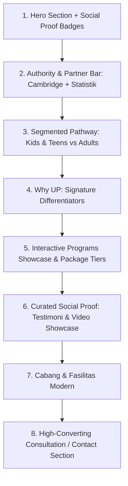
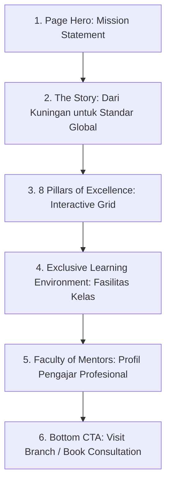
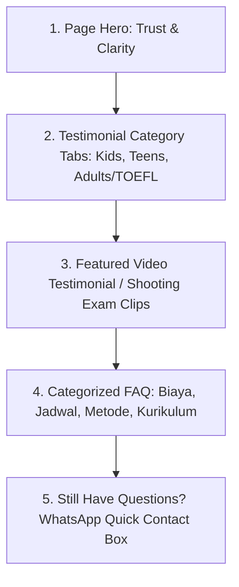

# Analisis & Rekomendasi Redesain Konten Landing Page (Halaman 1–4)
## Berdasarkan Kebutuhan Marketing Modern & Eksklusivitas Brand

Dokumen ini disusun sebagai panduan strategis untuk menyelaraskan konten, struktur, dan tata letak (*layout*) dari 4 halaman publik utama UP Speaking Learning Centre (UP SLC):
1. **Halaman Beranda (Home Page)** — `app/(landing)/page.tsx`
2. **Halaman Tentang Kami (About Page)** — `app/(landing)/about/page.tsx`
3. **Halaman FAQ & Testimoni (FAQ & Testimonials Page)** — `app/(landing)/faq-testimonials/page.tsx`
4. **Halaman Program Belajar (Programs Page)** — `app/(landing)/programs/page.tsx`

---

## I. Landasan Strategis: Marketing Modern & Eksklusivitas Brand

### 1. Kebutuhan Landing Page untuk Marketing Edukasi
- **Dual-Audience Funneling**: UP SLC melayani dua segmen konsumen dengan motivasi dan *pain points* yang sangat berbeda:
  - *Segmen 1: Orang Tua Siswa (Moms & Dads)*: Mengutamakan kepercayaan, keselamatan, legalitas kurikulum internasional (Cambridge), pembentukan karakter percaya diri anak, lingkungan yang ramah, dan fasilitas modern.
  - *Segmen 2: Mahasiswa & Dewasa Muda / Profesional*: Mengutamakan efisiensi waktu, fleksibilitas jadwal, peningkatan skor TOEFL/IELTS, kesiapan wawancara kerja, dan kelancaran berbicara (*fluency*).
- **Dual-CTA Strategy (High Commitment vs Low Friction)**:
  - Pengunjung baru jarang langsung berkomitmen melakukan pendaftaran berbayar.
  - Perlu kombinasi antara **Primary CTA** (*"Konsultasi & Amankan Kuota"* / *"Daftar Sekarang"*) dan **Secondary Low-Friction CTA** (*"Ikuti Online Placement Test Gratis"* / *"Coba Trial Class"*).
- **Social Proof di Area Above-The-Fold**: Keyakinan calon pelanggan dibangun dalam 5 detik pertama. Logo mitra, status akreditasi kurikulum Cambridge, dan jumlah lulusan harus terlihat tanpa perlu menggulir (*scroll*) jauh ke bawah.

### 2. Membangun Eksklusivitas Brand (*Premium & High Perceived Value*)
- **Eksklusivitas Bukan Berarti Mahal, Melainkan Berkualitas Tinggi & Terbatas**:
  - *Bukan kelas massal*: Menekankan batasan kapasitas kelas kecil (Semi-Private 5–8 orang, Private 2 orang, Exclusive 1-on-1).
  - *Scarcity (Kelangkaan)*: Sistem kuota terbatas per batch untuk menjaga rasio perhatian tutor ke setiap siswa.
- **Signature Feature yang Menonjol**:
  - Fitur *"Shooting Examination"* dan *"UP Club"* adalah keunikan yang tidak dimiliki kursus lain. Ini harus dikemas sebagai portofolio eksklusif siswa, bukan sekadar tes biasa.
- **Visual & Typography Standards**:
  - Kurangi penggunaan teks panjang tanpa pemisah visual (*visual fatigue*).
  - Tampilkan foto asli fasilitas, kegiatan belajar riil, dan dokumentasi studio shooting, bukan ilustrasi grafis generik atau foto stok.

---

## II. Evaluasi & Rekomendasi: Halaman 1 — Beranda (Home)

### 1. Diagnosis Kondisi Saat Ini
- **Hero Section**: Headline *"UP YOUR WORDS, UP YOUR WORLD!"* sangat kuat, namun hanya memiliki satu tombol CTA tunggal (*"Registrasi"*). Tidak ada social proof instan (logo Cambridge, rating kepuasan orang tua, jumlah lulusan).
- **Why Us Section**: Menggunakan kartu accordion interaktif dengan interval rotasi otomatis 3 detik yang dapat mengganggu kenyamanan membaca pengguna di perangkat mobile. Ada 6 poin keunggulan penting yang justru disembunyikan/dikomentari di kode (*Confidence First, Small Group, Modern Class, dll.*).
- **Struktur Alur Konten**: Social proof pencapaian (*2.400+ lulusan*) diletakkan di tengah bawah setelah program, sehingga momentum keyakinan pengunjung datang terlambat.

### 2. Rekomendasi Perubahan Struktur & Urutan Halaman



### 3. Konten yang Ditambahkan, Dihapus, dan Diubah
| Aksi | Bagian | Rincian Perubahan Konten | Rationale Marketing & Eksklusivitas |
| :--- | :--- | :--- | :--- |
| **DITAMBAHKAN** | Hero Section | 1. Tambahkan sub-headline: *"Kursus Bahasa Inggris Berstandar Cambridge dengan Fokus 100% Membangun Kepercayaan Diri Bicara."*<br>2. Tambahkan **Secondary CTA**: *"Ikuti Free Placement Test"* (berdampingan dengan tombol *"Konsultasi / Registrasi"*).<br>3. Tambahkan trust badge: *"Cambridge Curriculum Official Prep • 2.400+ Alumni • Rating 4.9/5"*. | Menurunkan hambatan masuk (*drop-off*), memberikan opsi bagi pengunjung yang belum siap bayar, dan menancapkan status reputasi global sejak detik pertama. |
| **DITAMBAHKAN** | Segmen Audiens | Tambahkan tombol switcher cepat: **"Untuk Anak & Remaja (TK–SMA)"** vs **"Untuk Mahasiswa & Dewasa (TOEFL/Karir)"**. | Membantu orang tua dan profesional langsung menemukan solusi yang relevan tanpa kebingungan. |
| **DIUBAH** | Why Us Section | Tampilkan **6 keunggulan premium** secara konsisten: <br>1. *Cambridge Curriculum sejak 2023*<br>2. *Kelas Eksklusif & Terbatas (Maks. 5–8 Murid)*<br>3. *Shooting Examination (Video Portfolio)*<br>4. *CEFR & HOTS Standard*<br>5. *Fasilitas Kelas Modern (Smart TV & AC)*<br>6. *UP Club Immersion*. | Membuka poin-poin yang sebelumnya di-comment out di kode agar diferensiasi brand terlihat solid dan bernilai tinggi. |
| **DIHAPUS / MODIFIKASI** | Animasi Shuffle | Hentikan pergantian otomatis 3 detik pada kartu accordion. Gantilah dengan interaksi hover (desktop) atau tab klik eksplisit (mobile). | Rotasi otomatis yang bergerak sendiri membuat teks sulit dibaca dan terkesan tidak terkendali. |
| **DIUBAH** | Partners / Social Proof | Pindahkan strip statistik (2.400++ lulusan, 20+ sekolah rekanan) ke tepat di bawah Hero Section. | Memperkuat kredibilitas sebelum pengunjung diperkenalkan pada harga atau katalog produk. |

---

## III. Evaluasi & Rekomendasi: Halaman 2 — Tentang Kami (About)

### 1. Diagnosis Kondisi Saat Ini
- **Cerita & Narasi**: Narasi berdirinya UP SLC pada 2021 di Kuningan sangat menginspirasi. Namun, penyajiannya masih berupa blok paragraf teks yang padat di sebelah kiri dan tumpukan 3 foto vertikal di sebelah kanan.
- **Mentors Showcase**: 12 mentor ditampilkan dalam kisi foto statis sederhana, belum mencerminkan kualifikasi akademik yang mendalam atau spesialisasi sertifikasi Cambridge mereka.
- **Ketiadaan Fasilitas & Lingkungan Fisik**: Walaupun modern class disebutkan, belum ada galeri foto fasilitas fisik (Smart TV, speaking space, studio rekaman shooting exam) yang menegaskan status premium institusi.

### 2. Rekomendasi Perubahan Struktur & Urutan Halaman



### 3. Konten yang Ditambahkan, Dihapus, dan Diubah
| Aksi | Bagian | Rincian Perubahan Konten | Rationale Marketing & Eksklusivitas |
| :--- | :--- | :--- | :--- |
| **DIUBAH** | Our Story Section | Ubah paragraf panjang menjadi format **Milestone Timeline**:<br>- **2021**: Lahir di Kuningan dengan metode *Connect & Communicate*.<br>- **2023**: Transformasi adopsi kurikulum Cambridge & ujian Shooting Video.<br>- **Kini**: 3 Cabang, 26 Staf Ahli, dan 500+ Siswa Aktif. | Menampilkan pertumbuhan eksponensial yang profesional dan meyakinkan calon mitra/orang tua. |
| **DITAMBAHKAN** | Kredensial Pengajar | Pada daftar mentor, tambahkan badge kredensial: *Cambridge Certified Instructor*, *TOEFL Specialist*, *Lulusan S1/S2 Pendidikan*, jam terbang mengajar. | Meningkatkan *authority* dan alasan kenapa orang tua bersedia membayar lebih untuk mutu tutor. |
| **DITAMBAHKAN** | Showcase Fasilitas | Buat satu section visual mandiri: **"Modern Class & Safe Environment"** yang menampilkan: <br>- Ruang ber-AC dengan Smart TV 43"<br>- Speaking Studio & Brainstorming Board<br>- Kebersihan & kenyamanan kelas berstandar premium. | Eksklusivitas brand sangat dipengaruhi oleh persepsi fisik tempat belajar anak. |
| **DIUBAH** | Layout Nilai Inti | Ubah tampilan 8 checklist values menjadi kartu berdesain modern 2x4 dengan ikon representatif, bukan sekadar list vertikal standar. | Menghindari tampilan datar (*boring bullet list*) dan membuat nilai jual mudah dipindai (*scannable*). |

---

## IV. Evaluasi & Rekomendasi: Halaman 3 — FAQ & Testimoni (FAQ & Testimonials)

### 1. Diagnosis Kondisi Saat Ini
- **Testimoni**: Menampilkan 13 ulasan siswa dalam 1 grid panjang. Semua jenis ulasan dicampur tanpa pemisah, serta kolom `program` pada data masih kosong. Pengunjung sulit menemukan ulasan yang relevan dengan situasinya.
- **FAQ**: Berisi 14 pertanyaan dalam 1 accordion tunggal dari atas ke bawah tanpa kategorisasi topik. Pengunjung yang hanya ingin tahu soal biaya harus membaca dari pertanyaan nomor 1 sampai 8.
- **Ketiadaan Bukti Hasil Riil**: Belum ada highlight pencapaian konkret (misal: *"Nilai rapor sekolah naik ke 100"*, *"Skor TOEFL tembus 550"*, atau cuplikan video hasil Shooting Exam).

### 2. Rekomendasi Perubahan Struktur & Urutan Halaman



### 3. Konten yang Ditambahkan, Dihapus, dan Diubah
| Aksi | Bagian | Rincian Perubahan Konten | Rationale Marketing & Eksklusivitas |
| :--- | :--- | :--- | :--- |
| **DITAMBAHKAN** | Filter Tab Testimoni | Sediakan tombol filter kategori ulasan: <br>1. **Semua Ulasan**<br>2. **Orang Tua Siswa (SD & SMP)**<br>3. **Siswa SMA & Prestasi Sekolah**<br>4. **Mahasiswa & Kelas TOEFL/Dewasa**. | Memberikan pembuktian sosial yang spesifik dan relevan (*hyper-relevant social proof*) sesuai profil calon murid. |
| **DITAMBAHKAN** | Outcome Highlights | Tampilkan kartu testimoni unggulan dengan badge hasil konkret (contoh: ulasan Azril Ilham yang berhasil mendapat nilai 100 di ulangan harian sekolah diberi label `[Prestasi Sekolah: Nilai 100]`). | Bukti hasil nyata (*tangible outcome*) adalah pemicu konversi terkuat dalam pemasaran edukasi. |
| **DIUBAH** | Restrukturisasi FAQ | Kelompokkan 14 FAQ ke dalam 4 tab / kategori rapi:<br>1. **Sistem Belajar & Metode** (Kapasitas kelas, 90 Minutes of Happiness, Shooting Exam)<br>2. **Kurikulum & Leveling** (Cambridge, CEFR, Placement Test)<br>3. **Biaya & Registrasi** (Biaya per sesi, cara daftar, paket kelas)<br>4. **Jadwal & Komunitas** (Reschedule, UP Club, kelas online). | Memperbaiki pengalaman pengguna (*UX*), mencegah kelelahan membaca, dan memudahkan pencarian jawaban. |
| **DITAMBAHKAN** | WhatsApp Floating Box | Tambahkan kartu kontak bantuan cepat di bawah FAQ: *"Masih punya pertanyaan spesifik? Hubungi Education Consultant kami via WhatsApp (Respon Cepat)*". | Menangkap calon siswa yang enggan membaca panjang dan ingin langsung bertanya hal teknis. |

---

## V. Evaluasi & Rekomendasi: Halaman 4 — Program Belajar (Programs)

### 1. Diagnosis Kondisi Saat Ini
- **Gap Paling Kritis (Missing Pricing & Package Tiers)**: Halaman ini hanya menampilkan 2 kartu horizontal besar (*School Program* & *Regular Program*). Pembeda eksklusif seperti **Semi-Private (5–10 orang)**, **Private (2 orang)**, dan **Exclusive (1-on-1)** sama sekali TIDAK ditampilkan di halaman ini, melainkan tersembunyi jauh di dalam step 5 form wizard `/select-program`.
- **Informasi Nilai Terlalu Abstrak**: Calon murid melihat durasi "48 Meetings" atau "16 weeks", tetapi tidak mendapatkan rincian kurikulum modular, target capaian kemampuan, maupun rentang estimasi investasi biaya belajar.
- **Alur Pendaftaran (Application Process)**: Disajikan dalam timeline vertikal yang memakan ruang tinggi tanpa interaktivitas.

### 2. Rekomendasi Perubahan Struktur & Urutan Halaman

```mermaid
graph TD
    A[1. Hero Section: Direct Pathways] --> B[2. Program Selector: School Program vs Regular Program]
    B --> C[3. Tiering Packages Matrix: Semi-Private | Private | Exclusive]
    C --> D[4. Detailed Curriculum & CEFR Milestones]
    D --> E[5. Transparent Investment Guide: Biaya Terjangkau & Opsi Cicilan]
    E --> F[6. Streamlined 4-Step Enrollment Process]
    F --> G[7. Final Conversion Banner with Dual-CTA]
```

### 3. Konten yang Ditambahkan, Dihapus, dan Diubah
| Aksi | Bagian | Rincian Perubahan Konten | Rationale Marketing & Eksklusivitas |
| :--- | :--- | :--- | :--- |
| **DITAMBAHKAN (KRUSIAL)** | Tabel Matriks Paket | Tampilkan komparasi 3 tingkatan paket kelas secara transparan di halaman program:<br>1. **Semi-Private (5–8 Siswa)**: Belajar kolaboratif interaktif.<br>2. **Private (2 Siswa)**: Pasangan belajar intensif untuk target khusus.<br>3. **Exclusive VIP (1 Siswa)**: Pembelajaran 1-on-1 dengan fleksibilitas jadwal penuh dan kurikulum personal. | Inilah inti dari eksklusivitas brand. Calon konsumen yang mencari layanan privat atau eksklusif harus bisa melihat opsi ini sebelum mendaftar. |
| **DITAMBAHKAN** | Indikator Level CEFR | Tampilkan diagram peta jalan (*learning roadmap*) dari level Pre-A1 (Starter) menuju C1 (Advanced) beserta target usia/jenjang. | Menunjukkan kejelasan kurikulum dan memberikan rasa pencapaian (*progression path*) yang terukur kepada orang tua. |
| **DIUBAH** | Komparasi Program | Ubah tampilan 2 kartu program menjadi kartu paket dengan rincian *what's included* (Buku panduan Cambridge, akses UP Club gratis, sesi Shooting Exam, laporan progres berkala). | Menegaskan bahwa biaya yang dibayarkan mencakup paket komprehensif (*all-in value*). |
| **DIUBAH** | Alur Pendaftaran | Ubah timeline vertikal 4 langkah menjadi horizontal stepper card yang ringkas: <br>1. *Daftar Online* ➔ 2. *Free Placement Test* ➔ 3. *Pilih Jadwal & Paket* ➔ 4. *Mulai Kelas*. | Menghemat ruang layar dan membuat proses masuk terlihat mudah dan cepat (*frictionless*). |
| **DITAMBAHKAN** | Garansi / Kemudahan | Tambahkan pernyataan kebijakan: *"Bisa Reschedule Jadwal"* dan *"Jaminan Kelas Bebas Tekanan"*. | Mengurangi keraguan (*risk aversion*) calon pendaftar. |

---

## VI. Matriks Ringkasan Rencana Aksi (Action Plan Summary)

Berikut adalah panduan eksekusi menyeluruh per halaman yang merangkum apa yang perlu dipertahankan, diubah strukturnya, ditambahkan, atau dihapus:

```
+----------------------------------------------------------------------------------------------------+
|                                  RINGKASAN STRATEGI HALAMAN 1 - 4                                  |
+--------------------------+----------------------------------+--------------------------------------+
| Halaman                  | Tindakan Struktural & Konten     | Dampak Bisnis & Brand                |
+--------------------------+----------------------------------+--------------------------------------+
| 1. Beranda (Home)        | - Tambah Secondary CTA Placement | - Meningkatkan conversion rate lead. |
|                          | - Geser Social Proof ke Atas     | - Memperkuat trust instan.           |
|                          | - Matikan shuffle timer Why Us   | - Mengurangi bounce rate pengguna.   |
|                          | - Buka opsi paket eksklusif      | - Menampilkan positioning premium.   |
+--------------------------+----------------------------------+--------------------------------------+
| 2. Tentang Kami (About)  | - Format Story jadi Milestone    | - Menegaskan kredibilitas sejarah.   |
|                          | - Tambah Galeri Ruang Kelas      | - Visualisasi brand eksklusif nyata. |
|                          | - Pasang Kredensial Cambridge    | - Menegaskan otoritas tim mentor.    |
|                          | - Ubah layout nilai jadi 2x4 card| - Meningkatkan kemudahan membaca.    |
+--------------------------+----------------------------------+--------------------------------------+
| 3. FAQ & Testimonials    | - Kelompokkan FAQ ke 4 kategori  | - Mengurangi beban kognitif user.    |
|                          | - Buat Filter Tab Testimoni      | - Testimoni tepat sasaran audiens.   |
|                          | - Highlight Nilai 100 & Prestasi | - Bukti hasil konkrit yang menjual.  |
|                          | - Tambah WhatsApp Quick Help Card| - Membuka saluran konsultasi cepat.  |
+--------------------------+----------------------------------+--------------------------------------+
| 4. Program Belajar       | - TAMPILKAN MATRIKS PAKET        | - Kunci utama eksklusivitas brand.   |
|                          |   (Semi-Private/Private/Exclusive)|                                      |
|                          | - Tampilkan Roadmap Level CEFR   | - Menunjukkan kejelasan hasil studi. |
|                          | - Ubah alur daftar jadi horizontal| - Alur registrasi terasa sederhana.  |
|                          | - Rinci fasilitas 'All-In'       | - Menjustifikasi perceived value.    |
+--------------------------+----------------------------------+--------------------------------------+
```

---

## VII. Rekomendasi Copywriting & Tone of Voice

Untuk menyeimbangkan antara keramahan (*approachable fun learning*) dan kemewahan/kualitas (*premium exclusivity*), disarankan membagi gaya bahasa:
1. **Untuk Segmen Sekolah (Anak & Orang Tua)**:
   - *Tone*: Mengayomi, suportif, berstandar internasional, meyakinkan (*warm, supportive, globally accredited*).
   - *Contoh Headline*: *"Bukan Sekadar Belajar Grammar — Kami Membimbing Buah Hati Anda Bicara Bahasa Inggris dengan Percaya Diri Sejak Dini."*
2. **Untuk Segmen Dewasa / Profesional**:
   - *Tone*: Efisien, terarah, berorientasi hasil, prestisius (*result-oriented, flexible, executive*).
   - *Contoh Headline*: *"Akselerasi Karier & Studi Global Anda dengan Pelatihan Speaking Personal dan Persiapan TOEFL Terstruktur."*

---

## VIII. Integrasi Strategis Produk Baru: UP Café
*(Belajar Bahasa Inggris Bersama UP SLC di Café-Café Rekanan Pilihan)*

### 1. Karakteristik & Daya Tarik Produk UP Café
- **Konsep Inti**: Sesi belajar dan latihan percakapan bahasa Inggris interaktif yang diselenggarakan di kafe-kafe estetik pilihan (*partner cafés*), memadukan bimbingan mentor profesional dengan suasana nongkrong santai (*casual lifestyle learning*).
- **Psikologi Konsumen & Nilai Eksklusivitas**:
  - **Menghilangkan Kecemasan (*Lower Anxiety*)**: Banyak orang dewasa dan remaja merasa terintimidasi di dalam ruang kelas formal. Suasana kafe dengan aroma kopi dan musik santai menurunkan ketegangan (*affective filter*) sehingga lebih spontan berbicara.
  - **Experiential & Instagrammable**: Mencerminkan gaya hidup modern kaum urban dan generasi muda.
  - **Ultra-Flexible & Social**: Menjadi sarana *networking* sosial sekaligus *study date* yang produktif.

---

### 2. Rekomendasi Penempatan Terbaik pada Halaman 1–4

```
+-----------------------------------------------------------------------------------------------------------------+
|                                 PETA PENEMPATAN PRODUK "UP CAFÉ" PADA WEBSITE                                  |
+-------------------+-----------------------------------------+---------------------------------------------------+
| Halaman           | Titik Lokasi Penempatan                 | Peran Strategis & Format Tampilan                 |
+-------------------+-----------------------------------------+---------------------------------------------------+
| Halaman 4         | Section "Special / Experiential Program"| RUMAH UTAMA PRODUK: Katalog detail program,       |
| (Programs)        | ATAU varian "Regular & Adult Edition"   | pilihan kafe rekanan, kapasitas grup (2-4 orang), |
|                   |                                         | dan tombol "Pilih Kafe & Booking Sesi".           |
+-------------------+-----------------------------------------+---------------------------------------------------+
| Halaman 1         | Spotlight Banner antara Programs &      | HOOK MARKETING & DIFFERENTIATOR: Pembeda radikal  |
| (Home)            | Testimonials ATAU di dekat Locations    | dari bimbel biasa. Menampilkan visual kafe        |
|                   |                                         | estetik & ajakan "Belajar Sambil Ngopi".          |
+-------------------+-----------------------------------------+---------------------------------------------------+
| Halaman 2         | Nilai Tambah "Real-World Immersion"     | BRAND ECOSYSTEM: Membuktikan bahwa UP SLC melatih |
| (About)           | (Evolusi UP Club & Modern Class)        | kepercayaan diri di dunia nyata, bukan cuma kelas.|
+-------------------+-----------------------------------------+---------------------------------------------------+
| Halaman 3         | Kategori FAQ Baru:                      | OBJECTION HANDLING: Menjawab mekanisme pemilihan  |
| (FAQ & Testi)     | "Sistem Belajar & Lokasi Kafe"          | kafe, paket F&B, dan jadwal fleksibel.            |
+-------------------+-----------------------------------------+---------------------------------------------------+
```

---

### 3. Blueprint Detail Eksekusi Per Halaman

#### A. Pada Halaman 4 (`/programs`) — **Rumah Utama Produk**
- **Opsi Penempatan Terbaik**: Tampilkan sebagai **Kartu Program Ketiga** atau **Special Hybrid Format**:
  - *Nama Program*: **UP Café: Casual & Experiential Speaking**
  - *Tagline*: *"Belajar Santai, Ngobrol Lancar di Kafe Favoritmu."*
  - *Format*: Sesi 90 Menit • Small Group (2–4 orang) atau Private 1-on-1 • Offline di Partner Cafés.
  - *Komponen Tampilan*:
    1. **Showcase Partner Cafés**: Carousel logo/foto kafe rekanan (misal: kafe-kafe populer & nyaman di Kuningan).
    2. **What's Included**: Topik diskusi terarah (*guided conversation prompt*), bimbingan tutor, segelas minuman favorit/voucher kafe, dan evaluasi speaking langsung.
    3. **CTA**: Tombol *"Lihat Pilihan Kafe & Jadwal"* ➔ mengarah ke flow pemilihan jadwal `/select-program`.

#### B. Pada Halaman 1 (`Home` — `/`) — **Hook Marketing & Pembeda Radikal**
- **Opsi Penempatan Terbaik**:
  - Letakkan sebuah **Spotlight Feature Card / Banner** di antara *Programs Section* dan *Locations Section*.
  - *Visual*: Foto asli tutor dan siswa sedang tertawa santai memegang cangkir kopi dengan materi Cambridge di atas meja kayu kafe estetik.
  - *Copywriting Headline*:
    > *"Bosan Belajar di Kelas Kaku? Cobain UP Café!"*
  - *Deskripsi Pendek*:
    > *"Tingkatkan kelancaran speaking bahasa Inggris sambil menikmati kopi favoritmu di puluhan kafe pilihan di Kuningan. Suasana santai, topik seru, percaya diri langsung naik!"*
  - *Tombol CTA*: *"Jelajahi UP Café"* ➔ `/programs#up-cafe`.

#### C. Pada Halaman 2 (`About` — `/about`) — **Memperkuat Narasi Movement**
- **Penempatan**: Masuk ke dalam poin **Pilar Pembelajaran ke-8 (UP Club & Ecosystem)**.
- **Narasi**: Menegaskan bahwa metode UP SLC tidak mengurung siswa di dalam 4 dinding kelas. Belajar bahasa Inggris adalah tentang interaksi nyata di masyarakat:
  > *"Melalui UP Café & UP Club, kami membawa bahasa Inggris langsung ke ruang sosial nyata. Siswa berlatih berinteraksi dengan percaya diri di dunia sebenarnya."*

#### D. Pada Halaman 3 (`FAQ & Testimonials` — `/faq-testimonials`) — **Mengatasi Keraguan Calon Murid**
Tambahkan sub-kategori FAQ seputar UP Café:
1. **Bagaimana cara kerja UP Café?**
   - *Jawaban*: Siswa memilih kafe rekanan terdekat dan jadwal yang diinginkan. Tutor UP SLC akan hadir di kafe tersebut membawakan materi percakapan tematik yang seru dan aplikatif.
2. **Apakah biaya kelas sudah termasuk makanan/minuman?**
   - *Jawaban*: Setiap paket sesi UP Café sudah include free voucher beverage di kafe rekanan kami.
3. **Berapa jumlah peserta dalam satu sesi UP Café?**
   - *Jawaban*: Dirancang eksklusif untuk 1–4 orang saja, memastikan setiap peserta mendapatkan porsi bicara maksimal dan tutor dapat mengoreksi pelafalan secara personal.

---

### 4. Dampak Penambahan UP Café terhadap Eksklusivitas Brand
1. **Meningkatkan Persepsi Nilai (*High Perceived Value*)**: Kursus yang memiliki jaringan kemitraan dengan kafe-kafe ternama terlihat lebih modern, dinamis, dan premium dibandingkan kursus tradisional.
2. **Menjangkau Pasar Dewasa/Mahasiswa yang Belum Tergarap Maksimal**: Kaum muda perkotaan enggan masuk ke "gedung bimbel sekolah anak-anak". UP Café menjadi pintu masuk (*gateway product*) yang sempurna bagi mereka.
3. **Memicu Organic Social Media Sharing (UGC)**: Siswa akan secara alami memotret dan membagikan pengalaman belajar di kafe ke Instagram Story / TikTok, menciptakan efek pemasaran viral tanpa biaya iklan besar.

---

## IX. Transformasi Strategis: Ketika UP Café Menjadi Program Utama (Flagship Brand Model)

Jika **UP Café ditetapkan sebagai PROGRAM UTAMA (*Flagship Product*)**, maka strategi website berubah secara **fundamental**. UP SLC tidak lagi diposisikan sebagai bimbel konvensional berbasis gedung kelas yang memiliki program kafe sampingan, melainkan sebagai **pelopor konsep pembelajaran bahasa Inggris berbasis *lifestyle & café learning* pertama dan terdepan**.

---

### 1. Perubahan Paradigma Brand & Arsitektur Informasi
```
SEBELUM (Model Lama):
[Brand: Bimbel Bahasa Inggris Kelas] ───> Program Utama: School Program (TK-SMA) & Regular Program (Gedung)
                                     └───> Program Sampingan: UP Café (Add-on)

SESUDAH (Model Baru - UP Café sebagai Flagship):
[Brand: The Premier Café & Lifestyle English Hub] ───> PROGRAM UTAMA: UP Café Series (Belajar di 20+ Kafe Pilihan)
                                                  └───> Campus & Foundation: School Program (Cabang Fisik)
```

---

### 2. Rekonfigurasi Halaman 1: Beranda (Home Page)
Ketika UP Café adalah program utama, Halaman Beranda harus langsung mengomunikasikan pembeda radikal ini sejak detik pertama:

- **Hero Section (Wajah Baru Brand)**:
  - **Visual Utama**: Mengganti background gelap kelas dengan visual terang, modern, dan estetik: foto mentor dan siswa sedang tertawa santai berdiskusi di sudut kafe estetik dengan cangkir kopi dan materi Cambridge.
  - **Headline Utama**:
    > **LEARN ENGLISH WHERE YOU LOVE TO HANGOUT.**
  - **Sub-headline**:
    > *"Tinggalkan ruang kelas kaku. Bersama UP Café, kuasai percakapan bahasa Inggris dengan percaya diri langsung di kafe-kafe favorit pilihanmu bersama mentor bersertifikasi Cambridge."*
  - **Dual CTA di Hero**:
    - Tombol Primer: **"Pilih Kafe & Mulai Belajar"** ➔ `/select-program?type=up-cafe`
    - Tombol Sekunder: **"Lihat Daftar Kafe Rekanan"** ➔ `/programs#partner-cafes`
- **Section Programs (Hierarki Baru)**:
  - **Kartu #1 (Featured / Most Popular)**: **UP Café Program** (Tampil paling besar dengan badge *"Flagship Program"*).
  - **Kartu #2**: **School Campus Program** (Untuk jenjang TK–SMP di gedung cabang fisik).
  - **Kartu #3**: **Academic & TOEFL Intensive**.
- **Locations Section (Re-branding Jaringan)**:
  - Bukan hanya menampilkan "3 Cabang Fisik", melainkan bertajuk:
    > **"3 Campus Hubs & 20+ Partner Café Network"**
  - Calon siswa melihat peta interaktif atau kisi galeri foto kafe rekanan di berbagai penjuru kota, memberikan kesan bahwa UP hadir di mana-mana dan sangat mudah diakses.

---

### 3. Rekonfigurasi Halaman 4: Program Belajar (Programs Page)
Halaman program menjadi etalase utama UP Café:

- **Hero Section**: Menegaskan *"The New Way of Learning English: Casual, Social, and Effective."*
- **UP Café Program Suite (Daftar Varian UP Café)**:
  1. **UP Café: Casual Conversation (Small Group 2–4 Orang)**: Untuk melatih kelancaran speaking sehari-hari bersama circle baru.
  2. **UP Café: Professional & Career (Semi-Private 2 Orang)**: Persiapan wawancara kerja, presentasi bisnis, dan networking.
  3. **UP Café: 1-on-1 VIP Mentoring (Exclusive)**: Pendampingan privat intensif dengan tutor senior di kafe privat/lounge.
- **Section "Bagaimana Cara Kerja UP Café?"**:
  - Langkah 1: *Pilih kafe rekanan favoritmu di kota*.
  - Langkah 2: *Pilih jadwal fleksibel (pagi, sore, atau malam)*.
  - Langkah 3: *Nikmati kopi gratis & bimbingan tutor seru selama 90 menit*.
- **Interactive Café Showcase**: Galeri visual kafe-kafe rekanan dengan filter area/kecamatan dan fasilitasnya (Wi-Fi kencang, area smoking/non-smoking, suasana tenang).

---

### 4. Rekonfigurasi Halaman 2: Tentang Kami (About Page)
Cerita berdirinya UP SLC dialihkan menjadi narasi perubahan (*The Rebellion against Boring English Classes*):

- **The Founder's Story**:
  > *"Kami melihat ribuan anak muda dan orang dewasa belajar bahasa Inggris bertahun-tahun di dalam kelas tertutup, namun tetap kaku dan takut saat harus berbicara di dunia nyata. Itulah mengapa kami melahirkan UP Café: memindahkan ruang belajar ke tempat di mana percakapan nyata terjadi setiap hari — di kafe, di tengah secangkir kopi, dan tawa yang santai."*
- **Nilai Eksklusivitas**: Menegaskan standar kurikulum Cambridge dan metode HOTS tetap diterapkan secara ketat meskipun dalam suasana kafe yang santai.

---

### 5. Rekonfigurasi Halaman 3: FAQ & Testimoni (FAQ & Testimonials Page)
- **Top Priority FAQ**: Seluruh blok FAQ teratas didedikasikan untuk menjawab rasa penasaran publik terhadap UP Café:
  1. *Apakah kafe tidak terlalu berisik untuk belajar?* ➔ Kami memilih kafe dengan area *quiet lounge* atau sesi jam kondusif terkurasi.
  2. *Apakah saya harus bayar makanan/minuman sendiri?* ➔ Setiap sesi sudah termasuk paket complimentary beverage voucher.
  3. *Bagaimana jika saya belum percaya diri berbicara di tempat umum?* ➔ Kelas berukuran mikro (1–3 orang) dengan tutor suportif yang menjaga kenyamanan privasi Anda.
- **Testimoni**: Menampilkan ulasan bertema *"Belajar berasa nongkrong, tapi speaking naik drastis!"* dari mahasiswa, freelancer, dan pekerja muda.

---

### 6. Matriks Perbandingan: Sebelum vs Sesudah UP Café Menjadi Program Utama

| Aspek Brand & Web | Model Awal (Bimbel Kelas Konvensional) | Model Baru (UP Café Flagship) |
| :--- | :--- | :--- |
| **Headline Hero Beranda** | *"Up Your Words, Up Your World"* (Umum) | *"Learn English Where You Love to Hangout"* (Spesifik & Provokatif) |
| **Visual Utama** | Foto ruang kelas / gedung / latar gelap | Foto estetik kafe, kopi, dan interaksi sosial santai |
| **Hirarki Program** | 1. School, 2. Regular, (UP Cafe sisipan) | 1. **UP Café (Utama)**, 2. School Campus, 3. TOEFL |
| **Persepsi Lokasi** | Terbatas di 3 gedung cabang Kuningan | Luas & Fleksibel: 3 Hub + 20+ Rekanan Kafe Pilihan |
| **Target Utama Pasar** | Mayoritas Orang Tua Murid Sekolah | Milenial, Gen Z, Mahasiswa, Profesional, & Remaja |
| **Posisi Eksklusivitas** | "Tempat les bagus di Kuningan" | **"The Coolest & Most Exclusive English Club in Town"** |


